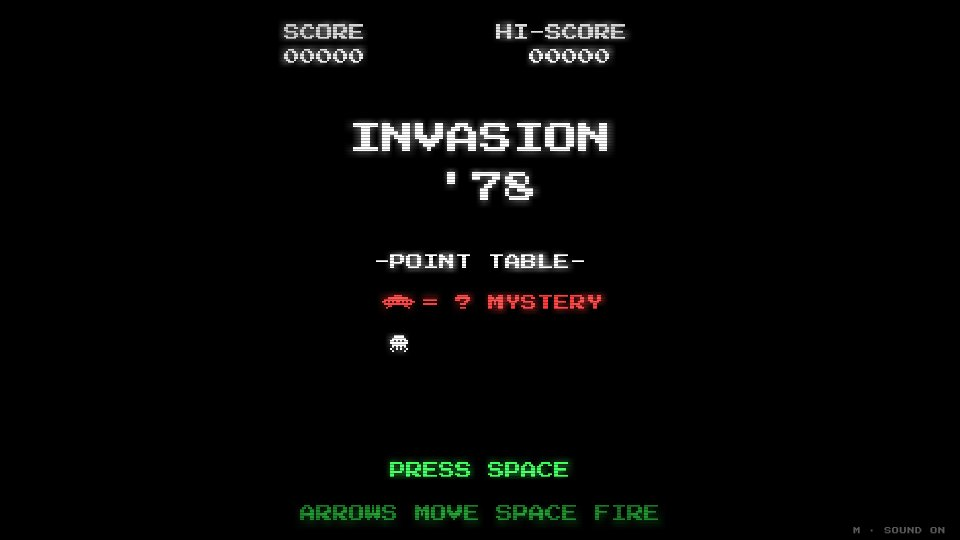
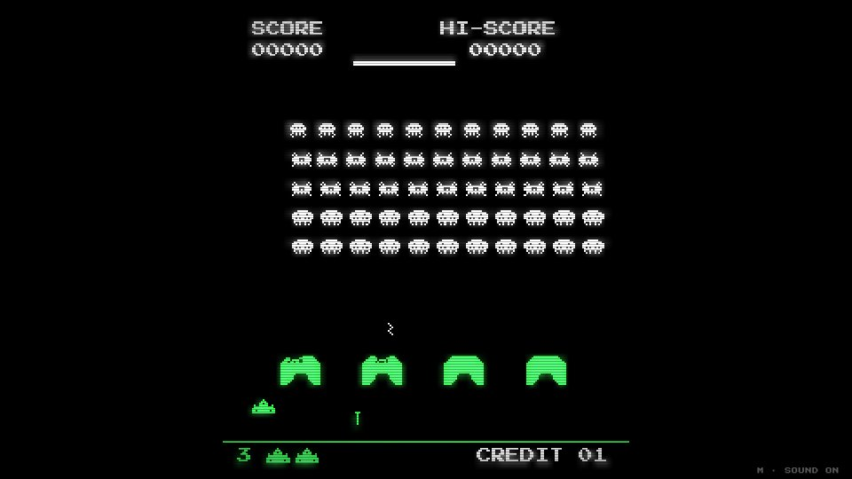
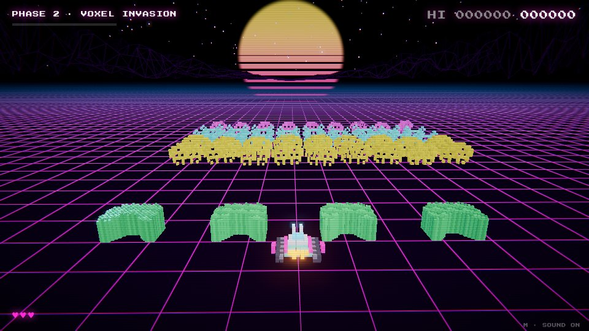
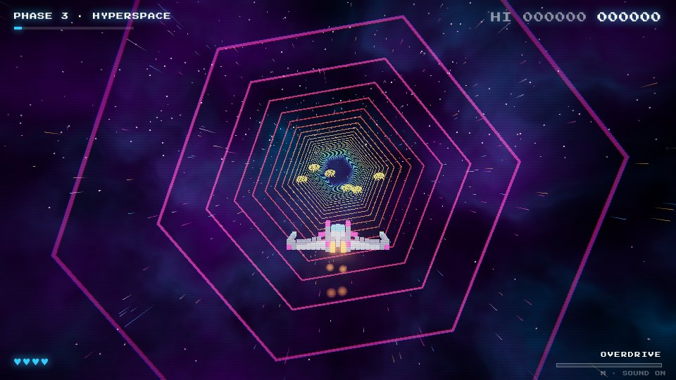
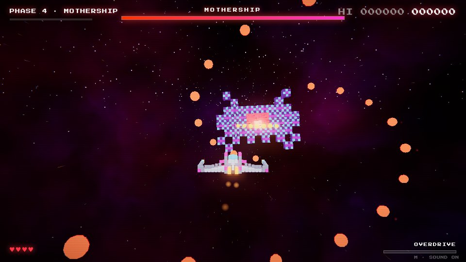

# INVASION '78

**A 1978 arcade shooter that refuses to stay in 1978.**

 

It starts as a black and white cabinet with green cellophane, crumbling bunkers and the four-note march. You get twenty seconds of that. Then the aliens turn red, the screen fills with bullets, GAME OVER flashes... and JUST KIDDING: the board lifts into 3D and the real game begins.

## The phases

| | Phase | What happens |
|---|---|---|
| 1 | **1978** | The classic arcade wave: bunkers that break pixel by pixel, a mystery saucer, the march that speeds up. After 20 seconds the storm comes. |
| 2 | **VOXEL INVASION** | The board rises into 3D on a synthwave grid. The bunkers keep their holes, aliens burst into physics cubes, and the saucer drops TRIPLE or RAPID fire. |
| 3 | **HYPERSPACE** | Your cannon rebuilds itself into a starfighter inside a hexagon tunnel: waves, asteroids, gold rings and NOVA, a screen-clearing slow-motion blast. |
| 4 | **MOTHERSHIP** | A WARNING siren, then a giant boss made of about 2,700 voxels that you shoot apart cube by cube. Bullet spirals, telegraphed lasers, swarms, and RAGE MODE under 50%. Hit the eye for CRIT. |

Beat the mothership and you can start again with **LOOP ×2**.

 

## Controls

| | Keyboard | Phone |
|---|---|---|
| Move / fly | `←` `→` (`↑` `↓` in 3D) or `WASD` | Drag |
| Fire | `Space` | Hold |
| NOVA (when charged) | `Shift` | Double tap or the NOVA button |
| Mute | `M` | |

**Secret level select:** type `222`, `333` or `444`, or tap the score.

## Under the hood

- One single `index.html`. No build step, no image files: every invader, bunker and voxel is generated in code.
- 3D with [three.js](https://threejs.org) plus bloom. All sound effects and music are generated live with the Web Audio API.
- Works on desktop and mobile, in landscape and portrait.

Run it locally by opening `index.html` in a browser, or with `python3 -m http.server`.

## More games in the series

| | |
|---|---|
| 🦖 [**404: Dino Not Found**](https://github.com/jeniaka/dino-404) | the offline dino runner that falls into 3D · [play](https://dino-404.pages.dev) |
| 👾 **INVASION '78** | you are here |
| 🤖 [**MUNCHBOT '80**](https://github.com/jeniaka/pacman) | a 1980 maze chase that becomes a crime city, a shooter and a donut in space · [play](https://pacman-gta.pages.dev) |

Built by <a href="https://github.com/jeniaka">jeniaka</a> with Claude

